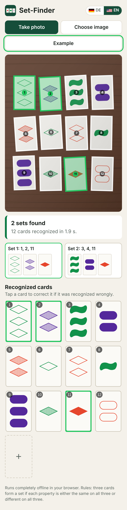

# Set-Finder

[Deutsch](README.de.md) · **English**

A mobile web app that helps with the card game **SET**: take a photo of the cards on the table with your phone
camera, and the app recognizes the cards and shows whether there are any sets and which ones. If there is no set,
it tells you to add three more cards.

**Try it:** <https://muetzenfrosch.github.io/setsolver/>

- **.NET 10 (LTS), Blazor WebAssembly**: runs entirely in the browser.
- **No server logic, no AI service**: the image recognition is classic image processing in C#.
  The photo never leaves the device.
- **Static files only**: any web server (Nginx, Apache, …) will do.
- **Works offline (PWA)**: after the first visit it also works without a network connection and can be added
  to the home screen.
- **English and German**: the app starts in German if the browser is set to German, otherwise in English.
- **Docker**: a small image with Nginx and the app, see [With Docker](#with-docker).

<p align="center">
  
</p>

## Usage

- **Take photo** opens the camera, **Choose image** uses an existing photo or a screenshot.
- The app numbers the recognized cards in the photo and lists all sets; the selected set is highlighted in green
  in the photo. If there is no set, it shows "No set: add 3 more cards."
- Under **Recognized cards** the cards are laid out in the same grid as in the photo (e.g. 3 × 4, 4 × 3, 5 × 3).
  If a card was not recognized, its spot stays empty with a "?". Uncertain cards have a dashed border.
  Tap any card to correct it, or tap an empty spot to fill it in.
- **Enter the cards by hand instead** works without any photo.
- **Example** creates a new layout of 12 random cards to try out, every time you tap it.
- **DE / EN** at the top right switches the language; the browser remembers your choice.

## Installation

### On your own web server

The [Releases](https://github.com/Muetzenfrosch/setsolver/releases) page has the ready-made app for every version
as `set-finder-webserver-<version>.zip`. Copy the contents of the zip into the root directory of your domain or
into any subfolder, and you are done. (Only in version 0.5 are the files still inside a `wwwroot` folder in the
zip.) Notes on Apache and Nginx are in [Publishing](#publishing) below; what changed in each version is in
[CHANGELOG.md](CHANGELOG.md) (in German).

To make a new version, add a section such as `## 1.2` to CHANGELOG.md and start the workflow **Releases**
(`.github/workflows/release.yml`) under Actions with that version: it creates the release `v1.2` with the text
from the changelog and attaches the zip. Alternatively, publish a release with a tag such as `v1.2` on GitHub
yourself; the workflow then builds the app and attaches the zip.

### On GitHub Pages

The workflow `.github/workflows/pages.yml` publishes the app on every push to `main` at
<https://muetzenfrosch.github.io/setsolver/>. GitHub Pages only has to be switched on once under
**Settings → Pages → Build and deployment → Source: GitHub Actions**; until then, the workflow only builds the app.
GitHub Pages uses HTTPS, so offline mode and "Add to Home Screen" work there as well.

### With Docker

The image contains only a small Nginx (the official `nginx:stable-alpine-slim` image) and the finished app,
about 14 MB in total (compressed). It is built straight from the source code; you do not need .NET installed.

```bash
git clone https://github.com/Muetzenfrosch/setsolver.git
cd setsolver
docker build --pull -t set-finder .
docker run -d -p 8080:80 --restart unless-stopped --name set-finder set-finder
```

The app is then running at <http://localhost:8080>.

**Updating:** thanks to `--pull`, every build uses the latest stable Nginx version (and the latest .NET 10 SDK
for building). To update the app and the web server, simply rebuild and replace the container:

```bash
git pull
docker build --pull -t set-finder .
docker rm -f set-finder
docker run -d -p 8080:80 --restart unless-stopped --name set-finder set-finder
```

The container only speaks HTTP. Offline mode and "Add to Home Screen" need HTTPS, for example through a reverse
proxy (Nginx, Traefik, Caddy, …) in front of the container. The Nginx configuration inside the image is in
`deploy/docker/default.conf`.

## The rule in one sentence

Three cards form a set if each of the four properties (number, color, shading, shape) is either the same on all
three cards or different on all three. If there is no set among the cards on the table, three more cards are
added. See [Wikipedia](https://en.wikipedia.org/wiki/Set_(card_game)).

## Structure

| Path | Contents |
| --- | --- |
| `src/SetGameSolver.Core/Model` | A card and its four properties |
| `src/SetGameSolver.Core/Solving` | Set search (all sets in a layout of any size) |
| `src/SetGameSolver.Core/Vision` | Image recognition: find, rectify and classify cards |
| `src/SetGameSolver.Core/Synthetic` | Card symbols as on the real cards, example images (SVG) and synthetic card photos for tests |
| `src/SetGameSolver.Web` | Blazor WebAssembly UI; all texts in English and German in `Localization/Texts.cs` |
| `tests/SetGameSolver.Core.Tests` | xUnit tests for the rules and the recognition |
| `deploy/nginx` | Sample Nginx configuration (Apache: `.htaccess` is published with the app) |
| `Dockerfile`, `deploy/docker` | Docker image and its Nginx configuration |
| `docs` | Screenshots for the READMEs |

## Development

Requirement: .NET SDK 10.

```bash
dotnet test                                  # all tests
dotnet watch --project src/SetGameSolver.Web # local development server
```

To test with a phone on the same Wi-Fi: `dotnet run --project src/SetGameSolver.Web --urls http://0.0.0.0:5000`.
The camera button opens the camera app through a normal file input, so it also works without HTTPS;
offline mode, however, needs HTTPS.

## Publishing

```bash
dotnet publish src/SetGameSolver.Web -c Release -o publish
```

The contents of `publish/wwwroot` (including the hidden file `.htaccess`) are the complete app. They can be
copied into the root directory of the domain **or into any subfolder** without changing anything. The GitHub
Actions workflow produces the same folder as the artifact `set-finder-wwwroot` and also test-builds the Docker
image.

### Nginx

Use `deploy/nginx/set-finder.conf` as a template and adjust `server_name` and `root`. What matters is the
MIME type `application/wasm`, `gzip_static on` for the precompressed files, and long cache times only for
`_framework/` (the file names there contain a hash).

### Apache

The included `.htaccess` sets the MIME types, serves the precompressed `.br`/`.gz` files and controls caching.
It needs `AllowOverride All` for the directory as well as `mod_rewrite` and `mod_headers`
(`a2enmod rewrite headers`).

## How the recognition works

1. The photo is rotated in the browser (EXIF) and scaled down to at most 1280 pixels on its longer side.
2. **Finding cards**: after a white balance based on the brightest parts of the image, card paper is whatever is
   bright, barely saturated and bright enough compared with its surroundings (so shadows and lighting gradients
   interfere less); strong brightness edges separate cards that lie close together. Connected regions with a
   rectangular shape and a matching aspect ratio count as cards; regions that have grown together are split step
   by step. Cards photographed at an angle appear as trapezoids; they count if their outline fits a quadrilateral
   with straight edges. The corners are determined from lines fitted to the edges. Regions much larger than the
   other cards (e.g. a tile as bright as the cards) do not count.
   If this finds hardly any cards, the search is repeated on the negative of the image. This also handles the
   dark mode of SET apps (black cards); their paper is treated as white for the analysis.
3. **Rectifying**: each card is transformed by a homography into a portrait image of 160 × 250 pixels.
4. **Classifying** (after a white balance on the card paper; shadows on the card are factored out because they
   only make the paper darker, not colored):
   - *Number*: count of symbol silhouettes.
   - *Shape*: convexity (squiggles are not convex) and the share of the bounding rectangle that is filled
     (diamonds ≈ 50 %, ovals ≈ 90 %).
   - *Shading*: amount of color inside the symbols relative to the outline (solid ≈ 1, striped ≈ 0.3, open ≈ 0).
   - *Color*: hue of the strongly colored pixels (green, purple, otherwise red).
   If a card extends beyond the edge of the image, only the visible symbols count and the card is marked as
   uncertain. Bold outlines (as in some SET apps) are skipped before the shading is measured.
5. **Layout grid**: each card is linked to its nearest neighbor to the right and below; rows and columns are
   counted along these links (also for layouts photographed at an angle). A gap of about twice the usual distance
   means an empty spot. The app shows the recognized cards in the same grid as in the photo (e.g. 3 × 4 or 4 × 3,
   with cards lying sideways shown sideways); where a card was not recognized, a spot with "?" stays empty.
6. The set search checks every pair of cards and looks up the one matching third card.

Uncertain recognitions are shown with a dashed border; every card can be corrected or removed in the app by
tapping it. An empty spot can be tapped to enter the missing card; cards can also be added by hand.

### Limits and next steps

The thresholds were tuned on 42 real photos (27 under artificial light, 15 in daylight; 513 cards on wood, tiles,
glass, carpet and a blanket) and 9 screenshots from SET apps (108 cards, including dark mode), which are stored as
test data in `tests/SetGameSolver.Core.Tests/Photos`; `labels.txt` describes each layout row by row (e.g.
`2RsO` = two red solid ovals; colors R/G/P, shading s/t/o = solid/striped/open, shapes D/O/S), and
`layouts.txt` describes its grid. Current state: 609 of 621 cards correct, 1 wrong (marked as uncertain),
11 not found, mostly because of hard shadows, reflections on foil or a bright surface that blends in with the
cards; the screenshots are recognized completely, and the grid is correct for all 51 images. To add new photos,
just put them there and label them.

Recognition works best when the cards do not touch each other and are photographed from above without hard
shadows or reflections. The surface may be patterned, but should not be as bright and shiny as the cards.

## How this was made

The code was written entirely by [Claude Code](https://claude.com/claude-code), Anthropic's AI assistant,
following my instructions. Every commit message contains the prompt (in German) that led to the change; the first
commit also contains the original project description. The app itself does not use any AI.

## License

The source code is licensed under the [MIT License](LICENSE). It does not cover the game SET, its name or the
design of its cards and symbols, nor the photos and screenshots in `tests/SetGameSolver.Core.Tests/Photos`;
see the following notice.

## Legal notice

SET is a card game invented by Marsha Falco. All rights to the game, its name, the design of its cards and
symbols and all related content belong exclusively to their respective owners. The same applies to the SET apps
from which the screenshots `IMG_3952` to `IMG_3960` in `tests/SetGameSolver.Core.Tests/Photos` were taken; they
are included solely as test data for the image recognition.

This repository is a private, non-commercial project. It is not affiliated with, endorsed or reviewed by any of
the rights holders. The card symbols in the app are my own redrawings, used only to display the recognized cards.

I do not intend to infringe any rights. If you hold rights to anything in this repository, or if anything here
bothers you, please contact me, preferably by opening an [issue](https://github.com/Muetzenfrosch/setsolver/issues).
I will take care of it promptly and remove or change the content in question if necessary.
