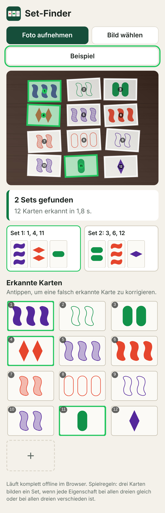

# Set-Finder

Eine Web-App fürs Handy, die beim Kartenspiel **SET** hilft: Man fotografiert die ausliegenden Karten mit der
Handykamera, die App erkennt die Karten und zeigt, ob und welche Sets darin liegen. Gibt es kein Set, meldet
sie, dass drei Karten nachgelegt werden müssen.

- **.NET 10 (LTS), Blazor WebAssembly**: läuft vollständig im Browser.
- **Keine Server-Logik, kein KI-Dienst**: Die Bilderkennung ist klassische Bildverarbeitung in C#.
  Das Foto verlässt das Gerät nie.
- **Nur statische Dateien**: Jeder Webserver (Nginx, Apache, …) genügt.
- **Offline-fähig (PWA)**: Nach dem ersten Besuch auch ohne Netz nutzbar und zum Startbildschirm hinzufügbar.

<p align="center">
  
</p>

## Bedienung

- **Foto aufnehmen** öffnet die Kamera, **Bild wählen** nimmt ein vorhandenes Foto oder einen Screenshot.
- Die App nummeriert die erkannten Karten im Foto und listet alle Sets auf; das gewählte Set wird im Foto
  grün markiert. Gibt es kein Set, erscheint „Kein Set: 3 Karten nachlegen“.
- Unter **Erkannte Karten** liegen die Karten im selben Raster wie auf dem Foto (z. B. 3 × 4, 4 × 3, 5 × 3).
  Wurde eine Karte nicht erkannt, bleibt ihr Platz mit „?“ frei. Unsichere Karten sind gestrichelt markiert.
  Jede Karte lässt sich antippen und korrigieren, ein freier Platz antippen und ausfüllen.
- **Karten lieber von Hand eingeben** funktioniert ganz ohne Foto.
- **Beispiel** erzeugt bei jedem Tippen eine neue Auslage aus 12 zufälligen Karten zum Ausprobieren.

## Installation auf dem eigenen Webserver

Unter [Releases](https://github.com/Muetzenfrosch/setsolver/releases) liegt für jede Version die fertige App
als `set-finder-webserver-<Version>.zip`. Den Inhalt des Zips in das Wurzelverzeichnis der Domain oder in einen
beliebigen Unterordner kopieren, fertig. (Nur bei Version 0.5 liegen die Dateien im Zip noch im Ordner
`wwwroot`.) Hinweise zu Apache und Nginx stehen unten unter [Veröffentlichen](#veröffentlichen), was sich in
jeder Version geändert hat, in [CHANGELOG.md](CHANGELOG.md).

Für eine neue Version genügt es, auf GitHub ein Release mit einem Tag wie `v1.1` zu veröffentlichen: Der Workflow
`.github/workflows/release.yml` baut dann die App und hängt das Zip an.

## Spielregel in einem Satz

Drei Karten bilden ein Set, wenn jede der vier Eigenschaften (Anzahl, Farbe, Füllung, Form) bei allen
dreien gleich oder bei allen dreien verschieden ist. Gibt es in der Auslage kein Set, werden drei Karten
nachgelegt. Siehe [Wikipedia](https://de.wikipedia.org/wiki/Set_(Spiel)) und
[Brettspielwelt](https://www.brettspielwelt.de/Hilfe/Anleitungen/Set/).

## Aufbau

| Pfad | Inhalt |
| --- | --- |
| `src/SetGameSolver.Core/Model` | Karte und ihre vier Eigenschaften |
| `src/SetGameSolver.Core/Solving` | Set-Suche (alle Sets in einer Auslage beliebiger Größe) |
| `src/SetGameSolver.Core/Vision` | Bilderkennung: Karten finden, entzerren, klassifizieren |
| `src/SetGameSolver.Core/Synthetic` | Kartensymbole wie auf den echten Karten, Beispielbilder (SVG) und künstliche Kartenfotos für Tests |
| `src/SetGameSolver.Web` | Blazor-WebAssembly-Oberfläche |
| `tests/SetGameSolver.Core.Tests` | xUnit-Tests für Regeln und Erkennung |
| `deploy/nginx` | Beispielkonfiguration für Nginx (Apache: `.htaccess` wird mit veröffentlicht) |
| `docs` | Screenshot für dieses README |

## Entwickeln

Voraussetzung: .NET SDK 10.

```bash
dotnet test                                  # alle Tests
dotnet watch --project src/SetGameSolver.Web # lokaler Entwicklungsserver
```

Zum Testen mit dem Handy im selben WLAN: `dotnet run --project src/SetGameSolver.Web --urls http://0.0.0.0:5000`.
Die Kamera-Schaltfläche öffnet die Kamera-App über ein normales Datei-Eingabefeld und funktioniert daher
auch ohne HTTPS; der Offline-Modus braucht dagegen HTTPS.

## Veröffentlichen

```bash
dotnet publish src/SetGameSolver.Web -c Release -o publish
```

Der Inhalt von `publish/wwwroot` (inklusive der versteckten Datei `.htaccess`) ist die komplette App.
Er kann in das Wurzelverzeichnis der Domain **oder in einen beliebigen Unterordner** kopiert werden,
ohne etwas anzupassen. Der GitHub-Actions-Workflow erzeugt denselben Ordner als Artefakt `set-finder-wwwroot`.

### Nginx

`deploy/nginx/set-finder.conf` als Vorlage nehmen, `server_name` und `root` anpassen. Wichtig sind der
MIME-Typ `application/wasm`, `gzip_static on` für die vorkomprimierten Dateien und lange Cache-Zeiten
nur für `_framework/` (die Dateinamen dort enthalten einen Hash).

### Apache

Die mitgelieferte `.htaccess` setzt MIME-Typen, liefert die vorkomprimierten `.br`/`.gz`-Dateien aus und
regelt das Caching. Nötig sind `AllowOverride All` für das Verzeichnis sowie `mod_rewrite` und `mod_headers`
(`a2enmod rewrite headers`).

## Wie die Erkennung funktioniert

1. Das Foto wird im Browser gedreht (EXIF) und auf höchstens 1280 Pixel Kantenlänge verkleinert.
2. **Karten finden**: Nach einem Weißabgleich auf die hellsten Bildstellen gilt als Kartenpapier, was hell,
   kaum gesättigt und im Vergleich zur Umgebung hell genug ist (so stören Schatten und Lichtverläufe weniger);
   starke Helligkeitskanten trennen dicht liegende Karten. Zusammenhängende Flächen mit Rechteckform und
   passendem Seitenverhältnis gelten als Karten, zusammengewachsene Flächen werden schrittweise getrennt.
   Schräg fotografierte Karten erscheinen als Trapez; sie zählen, wenn ihr Umriss zu einem Viereck mit geraden
   Kanten passt. Die Ecken werden über an die Kanten angepasste Geraden bestimmt. Flächen, die viel größer als
   die übrigen Karten sind (z. B. eine Fliese so hell wie die Karten), zählen nicht.
   Findet sich so kaum eine Karte, wird die Suche mit dem Negativ des Bildes wiederholt. Damit klappt auch der
   Dunkelmodus von Set-Apps (schwarze Karten); deren Papier wird für die Auswertung weiß gerechnet.
3. **Entzerren**: Jede Karte wird per Homographie in ein Hochformat-Bild von 160 × 250 Pixeln umgerechnet.
4. **Klassifizieren** (nach Weißabgleich auf das Kartenpapier; Schatten auf der Karte werden herausgerechnet,
   weil sie das Papier nur dunkler, aber nicht farbig machen):
   - *Anzahl*: Zahl der Symbol-Silhouetten.
   - *Form*: Konvexität (Wellen sind nicht konvex) und Flächenanteil im umgebenden Rechteck (Rauten ≈ 50 %, Ovale ≈ 90 %).
   - *Füllung*: Farbanteil im Inneren der Symbole relativ zum Umriss (voll ≈ 1, gestreift ≈ 0,3, leer ≈ 0).
   - *Farbe*: Farbton der kräftig gefärbten Pixel (Grün, Lila, sonst Rot).
   Ragt eine Karte über den Bildrand, zählen nur die sichtbaren Symbole, und die Karte gilt als unsicher.
   Kräftige Umrisse (wie in manchen Set-Apps) werden vor dem Messen der Füllung übersprungen.
5. **Raster der Auslage**: Jede Karte wird mit ihrem nächsten Nachbarn rechts und unten verbunden; entlang
   dieser Verbindungen werden Zeilen und Spalten abgezählt (auch bei schräg fotografierten Auslagen). Ein etwa
   doppelter Abstand bedeutet einen freien Platz. Die erkannten Karten erscheinen in der App im selben Raster
   wie auf dem Foto (z. B. 3 × 4 oder 4 × 3, quer liegende Karten auch quer); wo eine Karte nicht erkannt wurde,
   bleibt ein Platz mit „?“ frei.
6. Die Set-Suche prüft jedes Kartenpaar und schlägt die eindeutig passende dritte Karte nach.

Unsichere Erkennungen werden gestrichelt markiert; jede Karte lässt sich in der App per Antippen korrigieren
oder entfernen. Ein freier Platz lässt sich antippen, um die fehlende Karte einzutragen; Karten können auch von
Hand hinzugefügt werden.

### Grenzen und nächste Schritte

Die Schwellwerte sind an 42 echten Fotos (27 bei Kunstlicht, 15 bei Tageslicht; 513 Karten auf Holz, Fliesen,
Glas, Teppich und Decke) und 9 Screenshots aus Set-Apps (108 Karten, auch im Dunkelmodus) eingestellt, die als Testdaten in `tests/SetGameSolver.Core.Tests/Photos` liegen;
`labels.txt` beschreibt jede Auslage zeilenweise (z. B. `2RsO` = zwei rote volle Ovale; Farben R/G/P,
Füllung s/t/o = voll/gestreift/leer, Formen D/O/S), `layouts.txt` ihr Raster. Stand: 609 von 621 Karten
richtig, 1 falsch (als unsicher markiert), 11 nicht gefunden – meist wegen harter Schatten, Spiegelungen auf Folie
oder hellem Untergrund, der mit Karten verschmilzt; die Screenshots werden vollständig erkannt, und das Raster
stimmt bei allen 51 Bildern. Neue Fotos einfach
dazulegen und beschriften.

Am besten funktioniert die Erkennung, wenn sich die Karten nicht berühren und von oben ohne harte Schatten oder
Spiegelungen fotografiert werden. Der Untergrund darf gemustert sein, sollte aber nicht so hell glänzen wie die Karten.

## Entstehung

Der Code ist vollständig mit [Claude Code](https://claude.com/claude-code), dem KI-Assistenten von Anthropic,
nach meinen Vorgaben entstanden. Jede Commit-Nachricht enthält den Prompt, der zu der jeweiligen Änderung geführt
hat; der erste Commit zusätzlich die ursprüngliche Projektbeschreibung. Die App selbst nutzt keine KI.

## Lizenz

Der Quellcode steht unter der [MIT-Lizenz](LICENSE). Sie gilt nicht für das Spiel SET, seinen Namen und die
Gestaltung seiner Karten und Symbole, und auch nicht für die Fotos und Screenshots in
`tests/SetGameSolver.Core.Tests/Photos`; siehe den folgenden Hinweis.

## Rechtlicher Hinweis

SET ist ein Kartenspiel von Marsha Falco. Alle Rechte am Spiel, an seinem Namen, an der Gestaltung der Karten
und Symbole sowie an allen weiteren damit verbundenen Inhalten liegen ausschließlich bei den jeweiligen
Rechteinhabern. Das gilt ebenso für die Set-Apps, aus denen die Screenshots `IMG_3952` bis `IMG_3960` in
`tests/SetGameSolver.Core.Tests/Photos` stammen; sie liegen dort nur als Testdaten für die Bilderkennung.

Dieses Repository ist ein privates, nicht kommerzielles Projekt. Es steht in keiner Verbindung zu den
Rechteinhabern und wird von ihnen weder unterstützt noch geprüft. Die Kartensymbole in der App sind eigene
Nachzeichnungen und dienen nur dazu, die erkannten Karten darzustellen.

Ich möchte mit diesem Projekt keinerlei Rechte verletzen. Wenn Sie Rechte an etwas in diesem Repository haben
oder Sie hier etwas stört, wenden Sie sich bitte an mich, am einfachsten über ein
[Issue](https://github.com/Muetzenfrosch/setsolver/issues). Ich kümmere mich umgehend darum und entferne oder
ändere die betreffenden Inhalte, wenn nötig.

### Legal notice

SET is a card game invented by Marsha Falco. All rights to the game, its name, the design of its cards and
symbols and all related content belong exclusively to their respective owners. The same applies to the SET apps
from which the screenshots `IMG_3952` to `IMG_3960` in `tests/SetGameSolver.Core.Tests/Photos` were taken; they
are included solely as test data for the image recognition.

This repository is a private, non-commercial project. It is not affiliated with, endorsed or reviewed by any of
the rights holders. The card symbols in the app are my own redrawings, used only to display the recognized cards.

I do not intend to infringe any rights. If you hold rights to anything in this repository, or if anything here
bothers you, please contact me, preferably by opening an [issue](https://github.com/Muetzenfrosch/setsolver/issues).
I will take care of it promptly and remove or change the content in question if necessary.
